---

### 👨‍💻 About Me

Software engineer focused on **Agentic AI systems, modern backend architectures, and algorithmic problem-solving**. I specialize in building stateful multi-agent workflows, scalable APIs, and robust data pipelines.

- 🤖 **Agentic AI:** Developing cyclical workflows, triage routers, and automated evaluation systems with **LangGraph** & **LangChain**.
- ⚡ **Backend Engineering:** Building high-performance, asynchronous REST APIs with **Python**, **FastAPI**, and **SQLAlchemy**.
- 🗄️ **Databases:** Relational schema modeling, query optimization, and transaction management with **PostgreSQL**.
- 💡 **Data Structures & Algorithms:** Practical problem-solving and algorithmic complexity optimization in **Java** and **Python**.

---

### 🛠️ Tech Stack & Arsenal

<table align="center" width="100%">
  <tr>
    <td align="left" width="22%"><b>AI &amp; Workflows</b></td>
    <td><code>LangGraph</code> <code>LangChain</code> <code>PyTorch</code> <code>Scikit-Learn</code> <code>NumPy</code> <code>Pandas</code></td>
  </tr>
  <tr>
    <td align="left"><b>Backend &amp; APIs</b></td>
    <td><code>Python</code> <code>FastAPI</code> <code>RESTful APIs</code> <code>Pydantic</code> <code>SQLAlchemy</code></td>
  </tr>
  <tr>
    <td align="left"><b>Databases</b></td>
    <td><code>PostgreSQL</code> <code>MySQL</code> <code>Database Normalization</code> <code>SQL Query Optimization</code></td>
  </tr>
  <tr>
    <td align="left"><b>Languages</b></td>
    <td><code>Python</code> <code>Java (Core &amp; DSA)</code> <code>SQL</code> <code>Bash / Shell</code></td>
  </tr>
  <tr>
    <td align="left"><b>Tools &amp; Systems</b></td>
    <td><code>Linux</code> <code>Git</code> <code>GitHub</code> <code>Docker (Foundations)</code> <code>VS Code</code></td>
  </tr>
</table>

 

  

---

### 📊 GitHub Activity & Real-Time Metrics

&nbsp;

 

---

### 📬 Connect With Me

&nbsp;

  

Progress over perfection. Build → Break → Understand → Ship. ⚡

