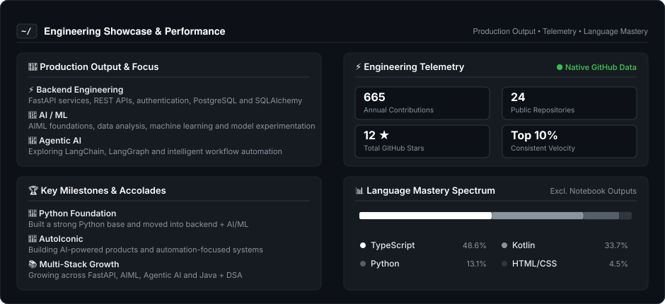

  

# JAIDUUU

**AI / ML • Agentic Systems • Backend Engineering**  
*Building useful software, learning deeply, and shipping projects.*

 

  

  
  

---

### 👨‍💻 About Me

I'm a developer focused on **AI/ML, backend engineering, and agentic AI**. I like turning what I learn into projects instead of keeping everything in notebooks and tutorials.

- 🤖 Exploring **Machine Learning & AI**
- 🧠 Building with **LangChain & LangGraph** (Iterative critique loops, stateful agents)
- ⚡ Developing APIs with **Python & FastAPI**
- ☕ Practicing **Java + DSA**
- 🗄️ Working with **PostgreSQL, SQL & SQLAlchemy**
- 🚀 Focused on real-world engineering and shipping reliable software

---

### 🛠️ Tech Stack & Capabilities

| Domain | Technologies & Frameworks |
| :--- | :--- |
| **Agentic AI & ML** | `LangGraph` `LangChain` `Groq API` `PyTorch` `Scikit-Learn` `NumPy` `Pandas` |
| **Backend & APIs** | `Python` `FastAPI` `REST APIs` `Pydantic` `SQLAlchemy` `Java (DSA)` |
| **Databases** | `PostgreSQL` `MySQL` `Database Design` `Complex SQL` |
| **Tools & Platforms** | `Git` `GitHub` `Linux / Bash` `VS Code` `Jupyter` |

 

---

### ⚡ Engineering Showcase & Highlights

  

---

### 📊 GitHub Activity & Metrics

&nbsp;

---

### 🤝 Let's Connect

&nbsp;

  

Progress over perfection. Build → break → understand → improve. ⚡

